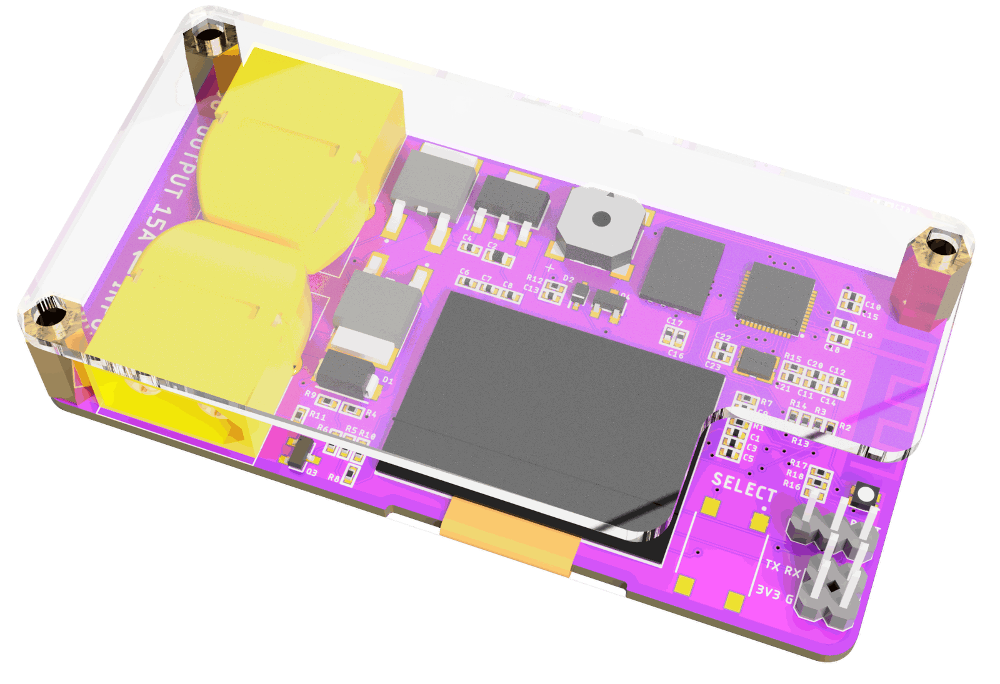
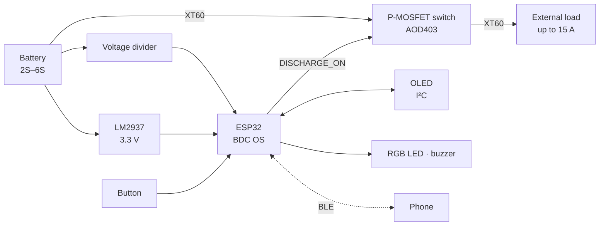
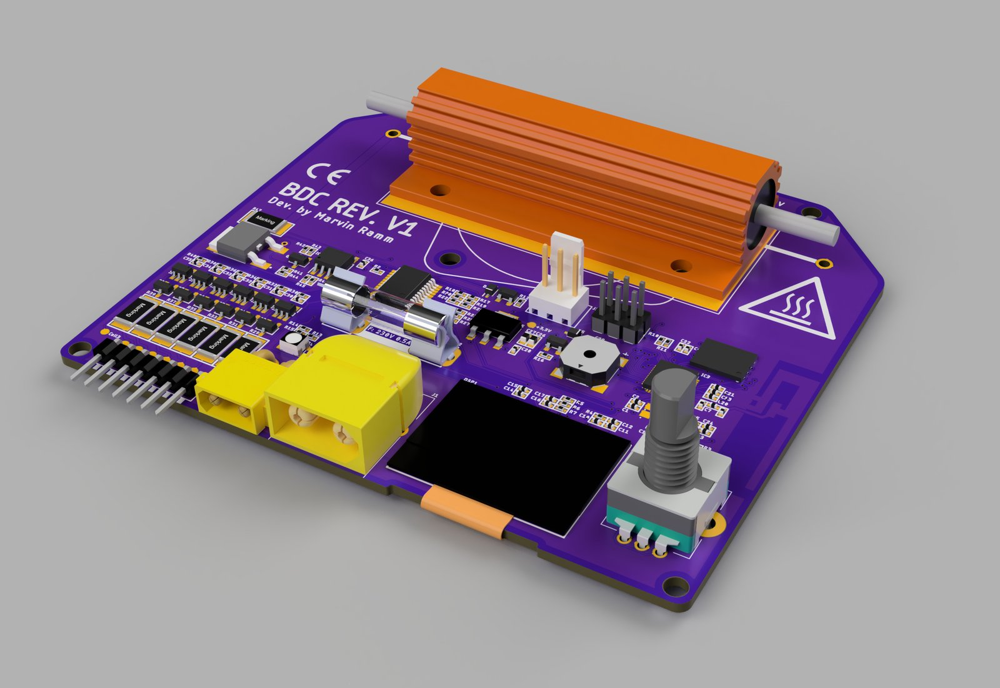
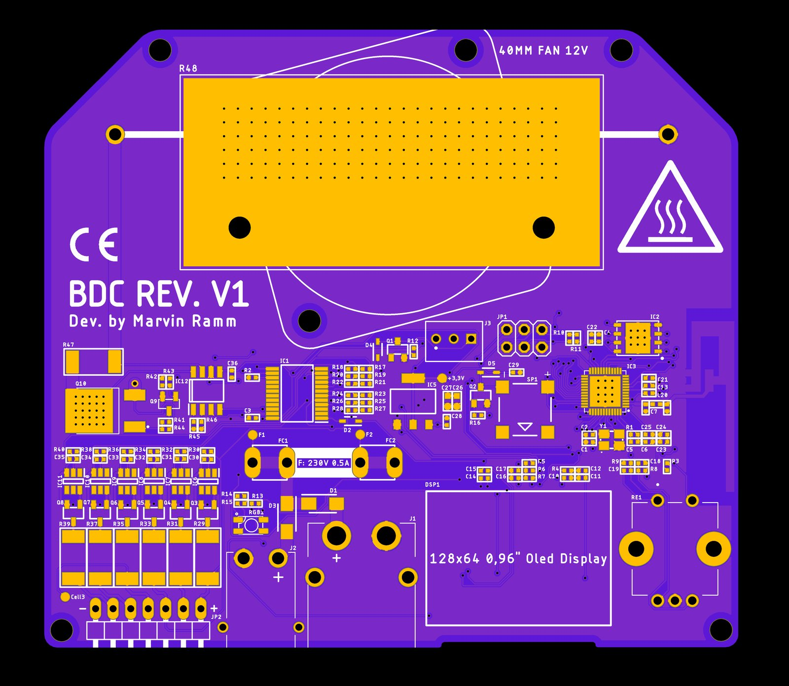

# BDC – Battery Discharge Controller

[](LICENSE)
[](hardware/LICENSE)

**Brings charged Li-Po and Li-Ion packs (2S–6S) down to storage voltage quickly. You set the target voltage per cell on the device. The BDC switches the load and stops on its own when the target is reached. An ESP32 runs its own firmware, BDC OS: it shows the progress on an OLED and streams it over Bluetooth LE.**

<p align="center">
  
</p>

In RC model building, packs are often charged and then not used. A full Li-Po left for days ages fast; it should sit at about 3.8 V per cell. Most chargers discharge with only a few watts. The BDC uses a real load instead and gets a pack to storage voltage much faster. The first revision carried that load on the board. The second one switches any external load up to 15 A.

## Features

- **2S to 6S Li-Po / Li-Ion:** the number of cells is detected from the pack voltage at start-up.
- **Adjustable target voltage:**
  - 3.60–3.90 V per cell in 0.05 V steps, 3.75 V by default
  - the load switches off automatically when the target is reached
- **Accurate measurement:**
  - the load is switched off briefly for every reading, so the voltage drop under load does not falsify the result
  - the ADC is linearised with a calibration table
- **One-button operation (REV2):**
  - short press changes the target voltage
  - long press starts or stops the discharge
  - an RGB LED shows the state: idle, discharging, done
- **0.96" OLED:**
  - cell voltage, pack voltage, distance to the target, progress in percent
  - Bluetooth status and the detected cell count
- **Bluetooth LE:** all values are sent as notifications, so a phone app can show the progress.
- **Buzzer** when the pack is done, then **light sleep** after one minute without input.

## How it works



The ESP32 measures the pack voltage through a voltage divider and averages 100 samples. During the reading it switches the load off for a moment. BDC OS converts the reading to a voltage with a measured calibration table and divides it by the detected number of cells. As long as the average cell voltage is above the target, the MOSFET stays on. When it drops 20 mV below the target, the BDC switches off, beeps and shows "Done".

## Revisions

<p align="center">
  
  
</p>

| | REV1 (2022) | REV2 (2023) |
|---|---|---|
| **Concept** | All-in-one: load, balancer and cell monitoring on one board | Compact controller that switches an external load |
| **Load** | 100 W / 8 Ω aluminium resistor on the board, cooled by a 40 mm fan | Any load on the second XT60 connector, up to 15 A |
| **Balancing** | Six HY2213 balancer channels with 62 Ω bleed resistors | – |
| **Measurement** | Every cell via the balancer connector and a CD74HC4067 multiplexer; current and power with an INA219 and a 10 mΩ shunt | Pack voltage via voltage divider |
| **Operation** | Rotary encoder with push button | One button |
| **Connectors** | XT60, XT30, balancer connector (up to 6S), fuse holders | 2 × XT60 |
| **Board** | 100.4 × 89.4 mm | 76.7 × 38.9 mm |
| **Firmware** | [BDC OS 0.4](firmware/BDC-OS-REV1) (prototype) | [BDC OS 0.5.3](firmware/BDC-OS) |

With a fixed 8 Ω resistor, the discharge current of REV1 depends on the pack voltage: about 1 A at 2S, about 3 A at 6S. For large packs that is slow, and the resistor needs active cooling. REV2 leaves out the load. You connect whatever fits the pack, e.g. a power resistor or an electronic load. The board itself becomes small enough for a 3D-printed or acrylic case.

## Repository layout

```
firmware/BDC-OS/          BDC OS 0.5.3 for REV2 (Arduino sketch)
firmware/BDC-OS-REV1/     BDC OS 0.4 for REV1 (prototype)
hardware/bdc-rev1/        Schematic (PDF), BOM, ESP32 pin assignment, EAGLE source
hardware/bdc-rev2/        Schematic (PDF), BOM, ESP32 pin assignment, EAGLE source
hardware/mechanical/      3D-printed parts
docs/images/              Pictures used in this README
```

Gerber files and ready-to-flash firmware images are attached to the [releases](https://github.com/marvinramm/BDC/releases). Libraries, build settings and the Bluetooth interface are described in [`firmware/README.md`](firmware/README.md).

> [!WARNING]
> The BDC handles batteries that can deliver very high currents. Fuse the battery line, watch the temperature of the load and never leave a discharging pack unattended.

## License

© 2022–2023 Marvin Ramm. Open source with attribution:

- Code (`firmware/`): [MIT](LICENSE)
- Hardware and documentation: [CC BY 4.0](hardware/LICENSE)

Commercial use is allowed. Credit "BDC by Marvin Ramm" with a link to this repository. Details are in [LICENSING.md](LICENSING.md).
